# HASANAH GYM
## UML & System Architecture | Concept v0.2
**Versi:** 0.2  |  **Tanggal:** 12 Oktober 2026  |  **Fokus Update:** Penambahan Absensi Staf, Shift Kasir, & Integrasi Hardware Scanner USB

---

## 01 | System Context Diagram
Diagram konteks sistem yang menggambarkan batas sistem HGMS dengan para aktor pengguna, perangkat keras scanner, dan layanan eksternal opsional.

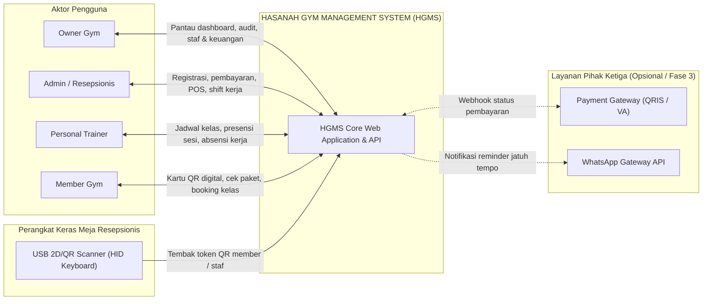

---

## 02 | Use Case Overview Diagram
Pemetaan peran pengguna terhadap fitur-fitur fungsional sistem, termasuk modul baru absensi karyawan dan shift kasir.

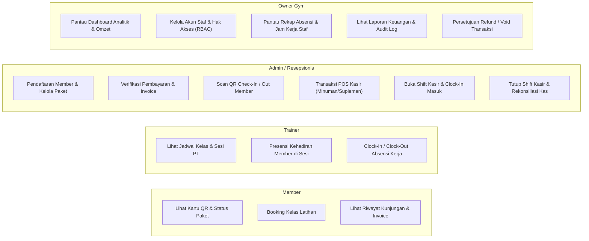

---

## 03 | Activity Diagram: Registrasi & Aktivasi Membership
Alur registrasi member baru hingga penerbitan token QR dan status paket aktif.

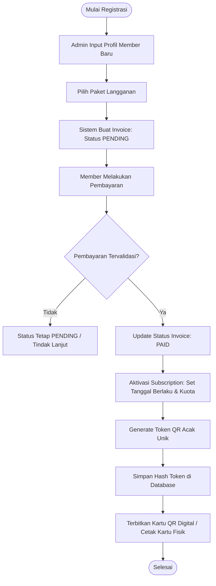

---

## 04 | Activity Diagram: Check-In Member (Scan QR)
Alur validasi real-time saat member datang ke gym dan melakukan pemindaian token QR di meja resepsionis.

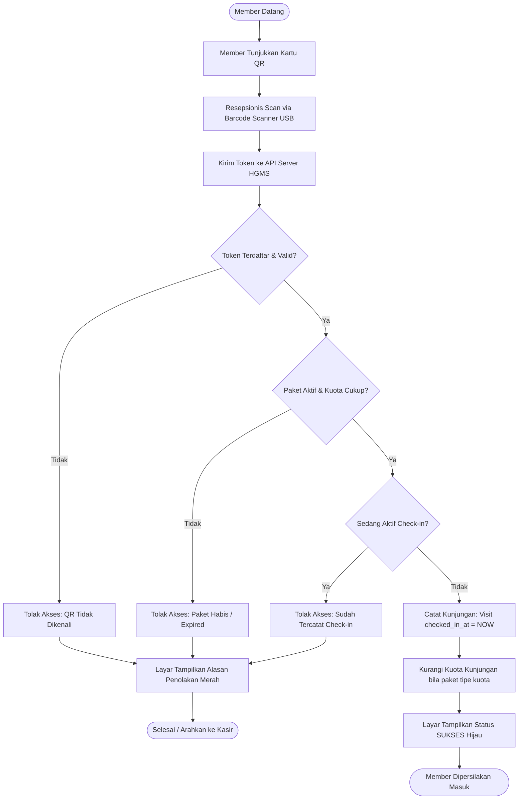

---

## 05 | Activity Diagram: Absensi Staf & Shift Kasir (BARU)
Alur pencatatan jam kerja staf, pembukaan shift kasir, dan penutupan kasir di akhir hari.

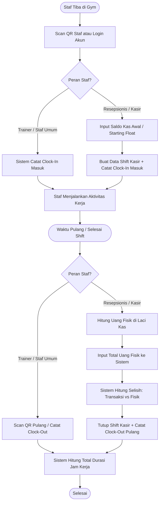

---

## 06 | Sequence Diagram: Pembayaran ke Aktivasi QR
Interaksi antarkomponen perangkat lunak dalam memproses pembayaran hingga penerbitan token akses.

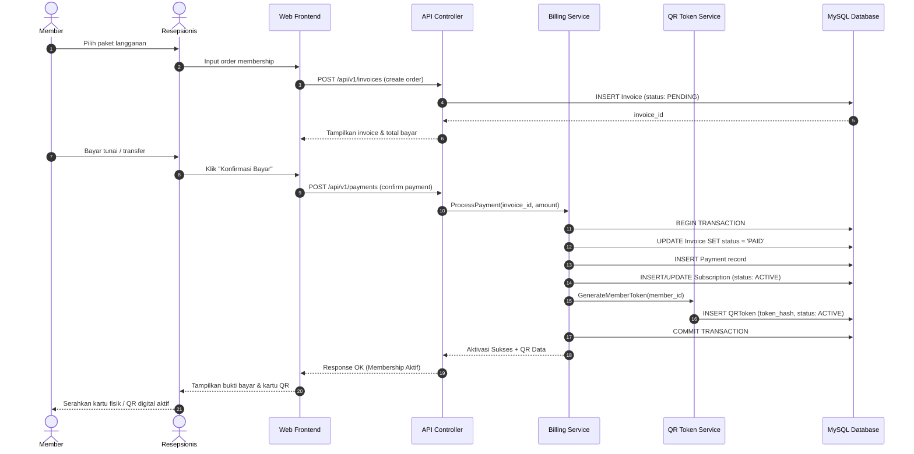

---

## 07 | Sequence Diagram: Absensi Staf via Scanner USB
Interaksi cepat saat staf men-scan kartu tanda pengenal staf di meja resepsionis.

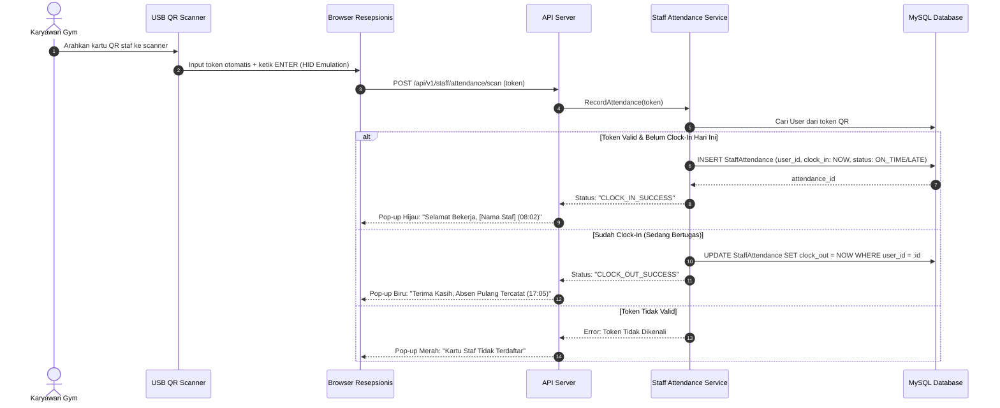

---

## 08 | Domain Class Diagram (Entity-Relationship)
Struktur entitas basis data relasional sistem dengan penambahan tabel `StaffAttendance` dan `CashShift`.

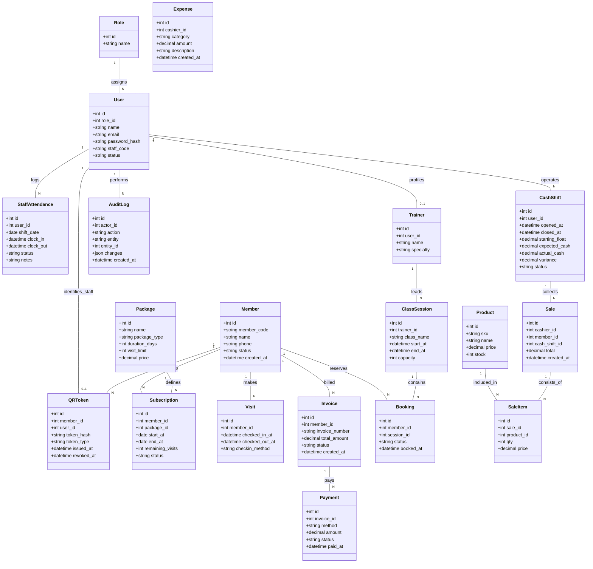

---

## 09 | Membership State Diagram
Siklus hidup status paket langganan member (*Subscription Lifecycle*).

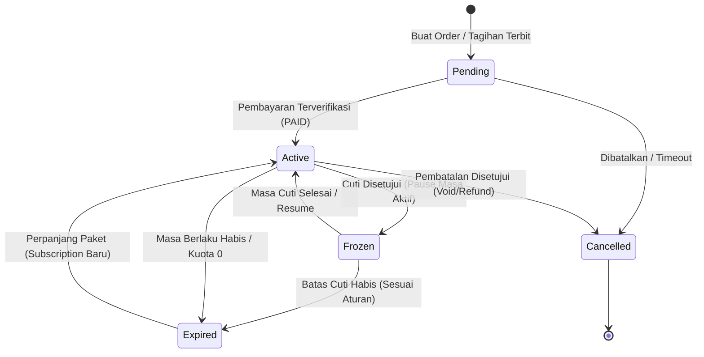

---

## 10 | Staff Shift & Attendance State Diagram (BARU)
Siklus status sesi shift kerja staf resepsionis dan pencatatan presensi.

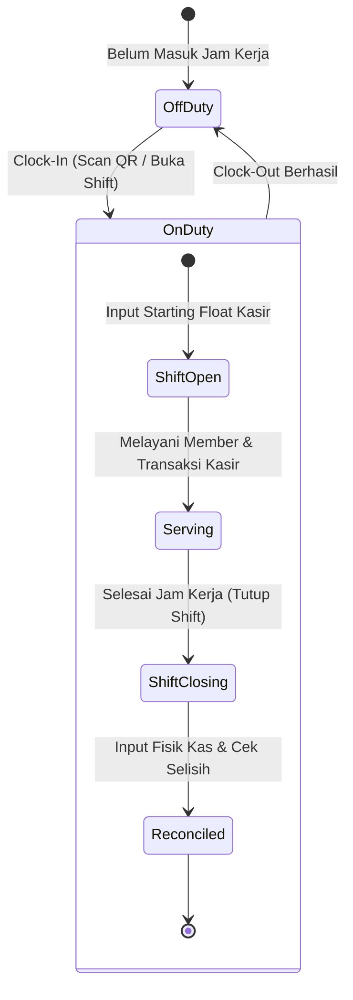

---

## 11 | Logical System Architecture
Arsitektur logis aplikasi web terintegrasi dengan modul-modul backend dan database terpusat.

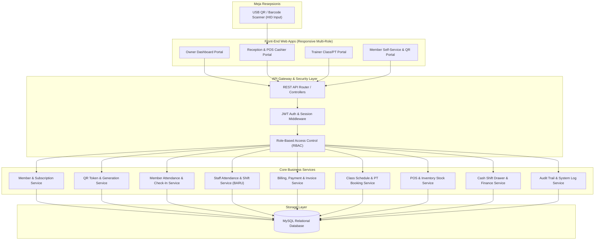

